<p align="center">
  
</p>

# Relay

[](https://github.com/iddogino/relay/actions/workflows/ci.yml)
[](https://github.com/iddogino/relay/releases)
[](LICENSE)

A very small, native Mac app that makes **persistent remote terminal sessions
feel like local terminal tabs**.

```
Remote (from ~/.ssh/config)
└── Project (a folder on that remote)
    └── Session (a persistent tmux session)
```

The terminal is a real [libghostty](https://github.com/ghostty-org/ghostty)
surface (Metal renderer) — your own Ghostty configuration (font, theme,
keybinds) can apply too (Settings ▸ Terminal). SSH and tmux are invisible
implementation details: if you can SSH to a machine and it has `tmux`, Relay
works without changing the remote machine in any way.

## What it does

- **Hosts** are Relay's own list (Settings ▸ Hosts), added by hand or
  imported from `~/.ssh/config` (`Include`, `Match` and wildcards evaluated
  in-app, jump hosts brought along). Relay connects with its built-in SSH
  client — no `ssh` process, so it runs in the App Sandbox — signing in with a
  Relay key (synced through iCloud Keychain, or kept in the Secure Enclave),
  your SSH agent, a key file (certificates too) or a password, through jump
  hosts like `ProxyJump`.
- **Projects** pin a folder on a remote, with an optional *launch command*
  (run in every new session — `claude`, `codex`, your worktree bootstrap
  script, anything) and an optional *shutdown command* (run when you archive a
  session — e.g. clean up that worktree).
- Aliases you never shell into (a git host, an OrbStack proxy) can be tucked
  away with **Hide Remote** in the sidebar context menu; View ▸ Show Hidden
  Remotes brings them back.
- **Sessions** are ordinary remote tmux sessions owned by the app. Close the
  laptop, lose Wi-Fi, quit the app — the remote work keeps running. Select the
  session again and Relay reattaches. They stay reachable from any terminal
  too: `ssh host`, `tmux attach -t rterm-…`.
- **Sync with iCloud** (on by default; Settings ▸ iCloud, per device) keeps
  your hosts, projects and their order, and the host keys you've trusted the
  same on every device signed in to your Apple Account — end-to-end
  encrypted — and host passwords and your GitHub sign-in with them, through
  iCloud Keychain. Sessions need no syncing: every device finds them on the
  hosts.

Launch commands receive a stable environment: `RTERM_PROJECT_ID`,
`RTERM_PROJECT_NAME`, `RTERM_PROJECT_PATH`, `RTERM_SESSION_ID`,
`RTERM_SESSION_NAME`, `RTERM_SESSION_SLUG` (the name slugified for
branch/folder use), `RTERM_REMOTE` (+ `RTERM_SHUTDOWN_REASON=archive` for
shutdown commands). The project editor has one-click presets — e.g.
`claude --worktree="$RTERM_SESSION_SLUG"` runs each session's agent in its
own worktree. Launch commands run in your remote **interactive login
shell** (`.zshrc`/`.bashrc`, aliases, nvm and friends all apply — the same
environment as typing the command yourself), with `~/.local/bin` and
`~/bin` additionally on PATH as a safety net. A launch command that fails
keeps its dead pane — and the error it printed — visible instead of
silently vanishing. Shutdown commands run without a tty, so they use a
login non-interactive shell with the same PATH safety net.

Two conveniences make the remote feel local:

- **Localhost links point at the right machine.** When something in the
  terminal prints `http://localhost:3000` and you ⌘-click it, Relay rewrites
  the loopback host to the session's remote (its hostname in Relay) and opens
  it in your local default browser. Ports, paths and queries are preserved;
  `*.localhost` virtual hosts are left alone.
- **Drop a file on the terminal to upload it.** The file (or folder) is
  streamed to a fresh scratch directory on the remote and the remote
  path is typed into the terminal, quoted. Hold ⌥ while dropping to insert
  the local path instead. Uploads show progress, can be cancelled, and clean
  up after themselves on failure; if you switch sessions mid-upload the
  finished path lands on your clipboard instead of in the wrong terminal.

**Archive Session** (⌘⇧E) ends a session cleanly: detach → kill the tmux
session → run your shutdown command (with retry if it fails). **Kill Session**
is the force escape hatch — it skips the shutdown command.

## Install

Grab the latest `Relay-<version>.dmg` from
[Releases](https://github.com/iddogino/relay/releases), open it, and drag
**Relay** into **Applications**. Builds are Developer ID-signed and
notarized. After that the app keeps itself current via
[Sparkle](https://sparkle-project.org): updates are offered in-app
(Relay ▸ Check for Updates…), downloaded from GitHub Releases, and verified
against both the appcast's EdDSA signature and Apple's notarization.
Prerelease installs stay on the `rc` channel automatically; stable installs
never see prereleases unless **Relay ▸ Receive Early Builds** is on.

## Building

Requirements: macOS 15+, Xcode 26 (Swift 6),
[XcodeGen](https://github.com/yonaskolb/XcodeGen). No third-party
dependencies besides pinned libghostty (built from source, see
[docs/GHOSTTY_PIN.md](docs/GHOSTTY_PIN.md)).

Both apps build from one Xcode project, generated from `App/project.yml`:
**Relay Direct**, the app distributed here (Sparkle updates, Developer ID),
and **Relay**, the App Store app — on the Mac the same UI in the App Sandbox,
without Sparkle, and on iPhone and iPad from the same target (one bundle ID,
one purchase). Run builds Relay Dev (`com.iddogino.Relay.dev`), which
installs next to Relay with its own data, Keychain group and preferences,
and never updates itself.

On iPad, Relay looks like the Mac: sessions beside the terminal. On iPhone
it's the session list, then one terminal — with one connection at a time.
Both have a key bar above the keyboard (Escape, Tab, Control, Option,
arrows…), take a hardware keyboard key by key, and drop their connections
shortly after going to the background (reconnecting on return). iOS signs
in to hosts with a Relay key or a password; a host set up on a Mac with its
agent or a key file needs one of those to connect from iOS.

```sh
Scripts/build-libghostty.sh   # once: fetch pinned Ghostty + Zig, build GhosttyKit
                              # (--universal adds iOS and the iOS Simulator)
brew install xcodegen
xcodegen --spec App/project.yml
open App/Relay.xcodeproj
```

Relay Dev signs with your development profile for `com.iddogino.Relay.dev`
(Xcode manages it). With iCloud on that App ID, it syncs through Relay's
container, `iCloud.com.iddogino.Relay`, in CloudKit's Development
environment, so it never sees a release's data.

`Scripts/build-tmux.sh` (needs Docker) builds the tmux Relay can install
on hosts that have none, into `build/tmux`: static Linux builds and a
universal macOS one, gzip'd. Both apps bundle it when it's there; without
it, Relay offers only the host's package manager.

`Scripts/archive-app.sh` builds `build/Relay.app` as a release ships it:
archived and exported Developer ID-signed. It needs the Developer ID
certificate and the "Relay Developer ID" profile, as the release workflow
has them.

## Testing

```sh
swift test              # unit tests (config parsing, quoting, codecs, persistence)
Scripts/live-e2e.sh     # live acceptance run against your two configured remotes
                        # (fully namespaced; cleans up after itself)
Scripts/live-e2e-cleanup.sh   # independent cleanup if a run crashed
Scripts/ios-ui-tests.sh # the iPhone and iPad app on fresh simulators, driven by
                        # its UI tests against a throwaway SSH host
```

CI runs `swift test` on every PR and push to `main`, builds both apps,
checking each with `Scripts/check-app.py`, and runs the iPhone and iPad UI
tests. The pinned GhosttyKit build is cached,
so only the first run after a pin bump pays the from-source build.

## Releasing

Push a tag of the form `v<semver>` (stable) or `v<semver>-<channel>.<seq>`
(prerelease), e.g.:

```sh
git tag v0.1.0-rc.1 && git push origin v0.1.0-rc.1
```

The [release workflow](.github/workflows/release.yml) tests, builds and
Developer ID-signs `Relay.app` (hardened runtime, with
`Scripts/archive-app.sh`), checks it, packages a
drag-to-Applications DMG, and publishes a GitHub release with the DMG and
SHA-256 checksums attached — marked *prerelease* automatically for channel
tags. It then EdDSA-signs the DMG and commits an updated
[`appcast.xml`](appcast.xml) to `main` (via
[Scripts/update-appcast.py](Scripts/update-appcast.py)), so installed
copies pick the release up through Sparkle; rc tags land on the `rc`
channel, stable tags on the default channel. Required repository secrets:
`MACOS_CERTIFICATE_P12` (base64 `.p12` with a Developer ID Application
identity), `MACOS_CERTIFICATE_PASSWORD`, `MACOS_PROVISIONING_PROFILE`
(base64 of the "Relay Developer ID" profile, which grants the Keychain
group and iCloud), and `SPARKLE_ED_PRIVATE_KEY` (Sparkle `generate_keys -x`
export). Optional: `APPLE_ID`,
`APPLE_TEAM_ID`, `APPLE_APP_SPECIFIC_PASSWORD` — when set, the DMG is also
notarized and stapled.

iCloud sync needs, once: iCloud (CloudKit, with the
`iCloud.com.iddogino.Relay` container) and Push Notifications on the
`com.iddogino.Relay` App ID, in the Developer ID profile; and Relay's
record types (`Host`, `Project`, `ProjectOrder`, made by Relay Dev in the
Development environment) deployed to Production in the CloudKit Console.

## Design notes

- `Sources/RelayCore` — domain model, `RuntimeProvider` abstraction, the
  SSH+tmux provider, persistence. No AppKit, no libghostty.
- `Sources/RelayUI` — the app's UI and model: SwiftUI views, the
  libghostty adapter (`Ghostty/`), and the attach/reconnect controller.
- `Sources/RelayCore/Sync` — iCloud sync: one record per host, project and
  the project order, in a zone of the private database, each an encrypted
  envelope sent by CKSyncEngine. Conflicts resolve per item, last writer
  wins; deletions are tombstones; a host that a project on another device
  still uses comes back. What sync knows is saved in state.json beside the
  items. CKSyncEngine fetches only when pushed, so Relay also catches up
  itself at launch and when it comes forward.
- `App/` — the apps (an XcodeGen project), both presenting `RelayUI`:
  `Direct/` adds Sparkle auto-updates; `Store/` is the App Store app, in
  the App Sandbox. Debug builds are Relay Dev, with its own Keychain group
  and data.
- Sessions you visit stay **warm**: the last 4 viewed sessions keep their
  ssh attachment and terminal state in the background, so switching between
  them is instant, their scrollback survives, and their sidebar titles stay
  live (hidden surfaces stop rendering via ghostty's occlusion API). Green
  dot = live connection, grey = none; right-click ▸ Disconnect drops a
  session's connection without touching the remote. Warm attachments die on
  disconnect, archive/kill/remove, LRU eviction, window close, and app quit
  — no connection ever outlives its sidebar row or the window. Never-visited
  (grey) sessions get their titles from a 30s tmux sweep instead.
- Management commands run as one-shot `ssh` invocations with `BatchMode=yes`,
  delivered to a remote `/bin/sh -s` over stdin — the remote login shell never
  parses generated script text, and every dynamic value is POSIX-quoted.
- The app only ever touches tmux sessions carrying its own `@rterm_*`
  metadata; your other tmux sessions are invisible to it.
- Relay sessions are tuned to feel like a plain native terminal: no status
  strip, mouse-wheel scrollback, passthrough sequences allowed, pane titles
  forwarded to the header. Launch commands additionally run with
  `TMUX`/`TMUX_PANE` scrubbed and `COLORTERM=truecolor` set — tmux is a
  persistence layer, not something your tools should adapt to (Claude Code,
  for example, statics its title spinner and clamps to 256 colors when it
  sees `$TMUX`). `TERM_PROGRAM=tmux` is kept so input protocols stay
  tmux-aware. When the tmux server runs only Relay sessions it
  also gets truecolor (`xterm-256color:RGB`), `escape-time 10`,
  `focus-events on`, and a 50k-line history — on a server shared with your
  own tmux sessions those server-wide settings are left alone.
- Measured footprint (Release, M2 Max, macOS 15.7): idle CPU ≈ 0% with no
  terminal and ≈ 0.4% with one attached idle terminal; ~102 MB RSS idle,
  ~115 MB with one attached terminal.
- Known cosmetic issue: macOS logs one "reentrant operation in its
  NSTableView delegate" warning at launch (SwiftUI sidebar internals; no
  functional impact).

Spec: [docs/remote-project-terminal-v1-spec.md](docs/remote-project-terminal-v1-spec.md).

## License

[MIT](LICENSE). Terminal emulation by
[libghostty](https://github.com/ghostty-org/ghostty) (MIT); not affiliated
with the Ghostty project.
